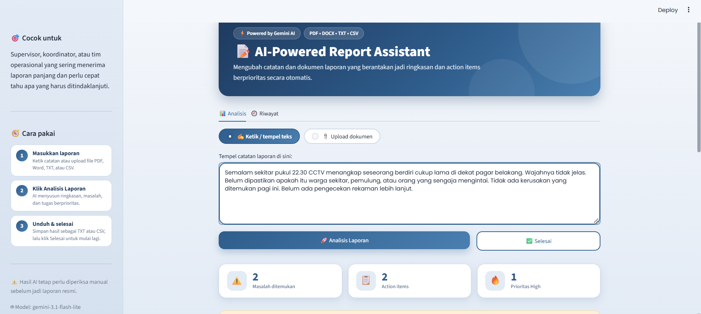
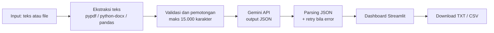

# 📝 AI-Powered Report Assistant

Aplikasi web yang mengubah catatan atau dokumen laporan operasional yang tidak terstruktur menjadi **ringkasan, daftar masalah, dan action items berprioritas** secara otomatis.

**Demo:** https://ai-report-assistant.streamlit.app/

> Catatan: ini project portofolio dengan data dummy. Kasus laporan keamanan dipakai sebagai simulasi, bukan klaim bahwa perusahaan tertentu memakai sistem ini.



---

## 1. Masalah yang diselesaikan

Laporan kegiatan harian sering ditulis sebagai catatan bebas yang panjang dan berantakan. Orang yang menerimanya harus membaca semuanya, mencari masalah penting, lalu menentukan apa yang harus ditindaklanjuti dan mana yang paling mendesak. Prosesnya manual, repetitif, dan mudah ada yang terlewat.

## 2. Solusi

Aplikasi ini menerima laporan dalam bentuk teks atau file (PDF, DOCX, TXT, CSV), lalu menggunakan LLM (Google Gemini) untuk:

- merangkum isi laporan,
- mengidentifikasi masalah,
- menyusun action items beserta prioritasnya (High / Medium / Low),
- menentukan status laporan (Selesai / Perlu tindak lanjut),
- menyediakan hasil yang bisa diunduh (TXT dan CSV).

## 3. Fitur

| Fitur | Keterangan |
|---|---|
| Input fleksibel | Ketik teks langsung, atau upload PDF, DOCX, TXT, CSV |
| Output terstruktur | LLM diminta mengeluarkan JSON, lalu ditampilkan sebagai kartu dan tabel |
| Mitigasi halusinasi | Prompt melarang menambah informasi; jika tidak ada masalah ditulis "Tidak disebutkan dalam laporan" |
| Penanganan error API | Retry otomatis dengan jeda bertahap saat server sibuk atau kena batas (429/5xx) |
| Riwayat sesi | Semua analisis dalam satu sesi tercatat dan bisa diunduh |
| Tombol Selesai | Mengosongkan input, file, dan hasil untuk memulai dari awal |

## 4. Alur sistem



## 5. Tech stack

Python · Streamlit · Google Gemini API (`google-genai`) · Pandas · pypdf · python-docx · python-dotenv

Model yang digunakan saat pengujian: **Gemini-3.1-flash-lite** (free tier)

## 6. Cara menjalankan

```bash
# 1. Clone repository
git clone [ISI URL REPOSITORY]
cd ai-report-assistant

# 2. Buat virtual environment
python -m venv venv
venv\Scripts\activate          # Windows
# source venv/bin/activate     # Mac / Linux

# 3. Install dependensi
pip install -r requirements.txt

# 4. Buat file .env berisi:
#    GEMINI_API_KEY=api_key_kamu
#    GEMINI_MODEL=nama_model_gemini

# 5. Jalankan
streamlit run app.py
```

API key bisa dibuat gratis di Google AI Studio. Jangan pernah meng-commit file `.env`.

## 7. Hasil pengujian

Pengujian dilakukan secara manual dengan **10 laporan dummy** (8 teks dan 2 dokumen) yang mencakup skenario: satu masalah, banyak masalah, tanpa masalah, sangat pendek, panjang dan berantakan, bahasa informal dan singkatan, banyak angka dan jam, informasi ambigu, serta file PDF dan DOCX (termasuk tabel).

Setiap laporan dinilai dengan 5 kriteria (Ya/Tidak): ringkasan benar, masalah lengkap, tidak ada informasi karangan, prioritas masuk akal, dan status benar. Kriteria "masalah lengkap" juga menghitung kejadian yang sudah ditangani di laporan.

| Metrik | Sebelum perbaikan prompt | Sesudah perbaikan prompt |
|---|---|---|
| Ringkasan benar | 9 dari 10 | **10 dari 10** |
| Masalah lengkap | 8 dari 10 | 8 dari 10 |
| Tidak ada informasi karangan | 10 dari 10 | 10 dari 10 |
| Prioritas masuk akal | 9 dari 10 | 9 dari 10 |
| Status benar | 10 dari 10 | 10 dari 10 |
| Laporan dengan skor sempurna (5/5) | 6 dari 10 | **7 dari 10** |
| Rata-rata skor (maks 5) | 4,6 | 4,7 |

Waktu penyusunan laporan (manual vs dengan aplikasi) diukur pada 3 laporan dengan stopwatch: rata-rata **hemat sekitar 74%** (sekitar 37 detik per laporan).

Angka di atas berasal dari lembar pengujian (`docs/lembar_pengujian.xlsx`). Penilaian dilakukan sendiri oleh pembuat, jadi bersifat subjektif dan berskala kecil. Perbaikan prompt hanya memperbaiki satu dari empat kasus yang salah, sehingga selisihnya belum cukup untuk menyimpulkan peningkatan yang signifikan.

### Perbaikan yang dilakukan

| Masalah yang ditemukan | Perbaikan | Hasil |
|---|---|---|
| Hasil analisis hilang saat tombol download diklik (Streamlit menjalankan ulang script) | Menyimpan hasil di `st.session_state` | Teratasi |
| Error 503 "high demand" dari API | Retry otomatis dengan jeda 2, 4, 8 detik | Teratasi |
| Error 429 karena batas harian free tier (beberapa model hanya 20 request per hari) | Pindah ke model dengan batas harian lebih besar dan menampilkan pesan error yang jelas | Teratasi |
| Ringkasan kurang lengkap pada laporan banyak angka | Ringkasan diperpanjang menjadi 2-4 kalimat dan wajib memuat angka serta jam penting | Teratasi |
| Masalah terlewat dan prioritas kurang tepat | Prompt ditambah pemeriksaan kalimat demi kalimat dan definisi High/Medium/Low | Belum sepenuhnya: yang masih terlewat adalah kejadian yang sudah ditangani |

Setelah prompt diperbaiki, enam laporan yang sebelumnya sempurna diuji ulang (regression test) dan semuanya tetap sempurna.

## 8. Keterbatasan

- PDF hasil scan (berupa gambar) belum bisa dibaca karena belum ada OCR.
- Format `.doc` lama tidak didukung, hanya `.docx`.
- Dokumen dipotong pada 15.000 karakter untuk menjaga kuota free tier.
- Riwayat hanya tersimpan selama sesi browser (tidak ada database).
- AI kadang melewatkan kejadian kecil yang sudah ditangani, dan penilaian prioritas bisa berbeda dengan penilaian manusia.
- Skenario "masalah yang sudah selesai" dan "prioritas campuran" belum diuji.
- Pengujian berskala kecil (10 laporan), dinilai manual oleh satu orang, dan hanya pada satu model.
- Hasil AI bisa keliru, sehingga tetap harus diperiksa manusia sebelum dijadikan laporan resmi.
- Menggunakan free tier dengan batas request per menit dan per hari yang berbeda tiap model, sehingga untuk penggunaan nyata perlu model berbayar atau pembatasan request.

## 9. Rencana pengembangan

- OCR untuk PDF hasil scan
- Simpan riwayat ke database
- Batch mode: upload banyak laporan sekaligus lalu ekspor satu rekap
- Integrasi workflow (misalnya kirim action items ke Google Sheets atau notifikasi otomatis)
- Memperluas set pengujian, termasuk skenario yang belum diuji

## 10. Privasi

Gunakan hanya data dummy. Pada free tier, Google dapat memakai input untuk meningkatkan produknya, jadi jangan memasukkan data rahasia atau data pribadi.

---

Dibuat oleh Rosa Linda Salsabila · https://www.linkedin.com/in/rosalindasb/
